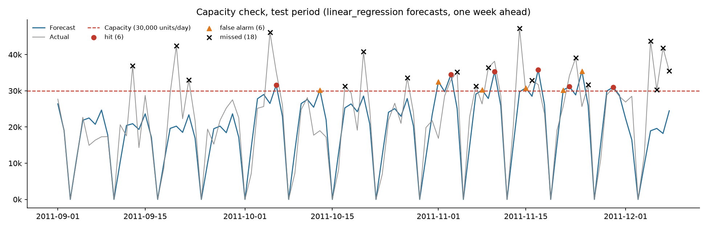
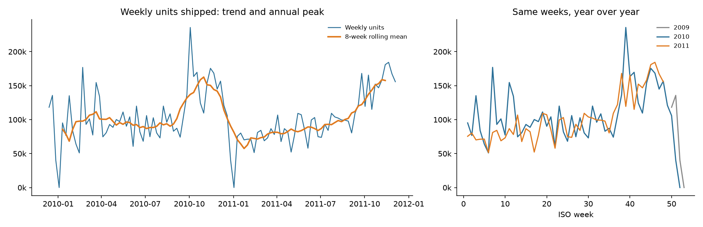
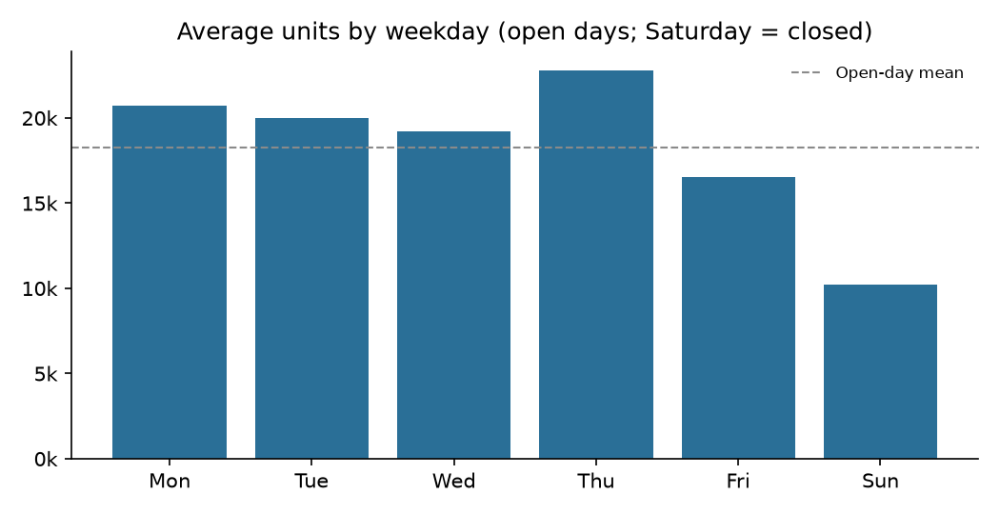
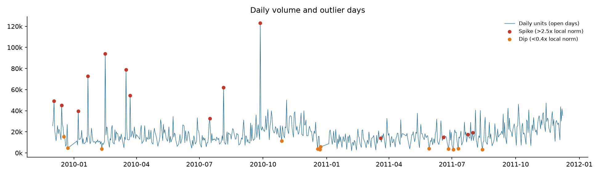

# Demand Forecasting & Warehouse Bottleneck Detection

> **How many units will the warehouse need to pick next week, and on which days will demand exceed capacity?**

This project forecasts daily outbound volume for a UK online wholesaler (real, public data) and flags **volume spikes**: days where forecast demand exceeds the site's daily pick/pack capacity. Those days need overtime, temporary labour or deferred dispatch to be planned in advance.

Three models are compared in an honest, time-ordered backtest against a seasonal-naive baseline. The results include where each model **fails**.

**Data:** [UCI Online Retail II](https://doi.org/10.24432/C5CG6D) (Chen, 2012), licensed CC BY 4.0. Real transactions, Dec 2009 – Dec 2011. See [data/README.md](data/README.md) for the cleaning steps.
**Capacity:** the dataset has no warehouse capacity, so **30,000 units/day is an assumed planning parameter** (about the 90th percentile of historical open-day volume). It is configurable.

---

## 1. Results at a glance

**Test period:** 1 Sep – 8 Dec 2011, the autumn peak (85 open days). Forecasts are 1–7 days ahead and the models are refit weekly.

| Model | MAE (units/day) | RMSE | MAPE | sMAPE | Bias | MAE vs baseline |
|---|---:|---:|---:|---:|---:|---:|
| **Linear regression (calendar features)** | **5,955** | 7,965 | 25.2% | **25.6%** | −9.5% | **−17.5%** |
| SARIMA (1,0,0)(0,1,1)₇ on log units | 5,993 | **7,953** | **24.1%** | 26.3% | −13.1% | −17.0% |
| Seasonal naive (same weekday last week) | 7,222 | 9,363 | 31.7% | 30.2% | −5.4% | baseline |

### Which model won, and why (honestly)

- **Both real models beat the baseline by about 17% on MAE.** That gain is meaningful: roughly 1,250 fewer units of error per day, or about 6–7 picker-hours at an assumed 200 units per hour.
- **Linear regression and SARIMA are effectively tied.** The regression wins MAE by **0.6%**, while SARIMA wins RMSE and MAPE. On 85 test days that gap is noise. I report the regression as the "winner" only because MAE was the metric fixed before testing.
- **They win in different situations:**
  - **SARIMA is better 1–2 days ahead** (MAE 4,980 vs 5,323) and **in early December**, because it follows the most recent level.
  - **The regression is better at seasonal turning points.** It knows January collapses after the Christmas shutdown. SARIMA has no annual seasonality and forecast peak-level volume (34k/day) for the first week of January 2012, which is clearly wrong.

### Where the models fail

| Failure | Evidence | Why |
|---|---|---|
| **The regression assumed December would drop, but it didn't** | Week of 5 Dec 2011: forecast about 19k/day, actual 30–44k/day (sMAPE 59%) | With only one previous December (2010, which fell away early), the month and Christmas-ramp effects are fitted on a single example. Two years of data cannot pin down annual seasonality. |
| **Single bulk orders** | Week of 19 Sep: one day hit 42k vs a typical 20k | Large wholesale orders are not predictable from the calendar. No model anticipates them. |
| **Sundays** | sMAPE about 41% for *every* model (vs 19–27% on weekdays) | Low, erratic Sunday volume |
| **Systematic under-forecasting of the peak** | Bias −9% to −13% for both models | The log-scale models are conservative, and 2011's peak ran slightly above 2010's |
| **Spike detection is weak** (see below) | Best recall 42%, from the *baseline* | Point forecasts are smoothed, so they rarely cross a capacity line that the actual series crosses because of spikes |

## 2. Bottleneck report



Backtest spike detection at 30,000 units/day. The actual volume exceeded capacity on 24 of 85 open days.

| Model | Flagged correctly (hits) | False alarms | Missed | Precision | Recall |
|---|---:|---:|---:|---:|---:|
| Seasonal naive | 10 | 10 | 14 | 50% | **42%** |
| SARIMA | 7 | 4 | 17 | **64%** | 29% |
| Linear regression | 6 | 6 | 18 | 50% | 25% |

**What this shows:** the most accurate model on average is *not* the best early-warning system. A model that minimises average error smooths away the peaks, and the peaks are exactly what capacity planning cares about. In practice the flag should use an **upper forecast quantile** (for example P80) rather than the point forecast; see "What I'd do next". I've left this unfixed so the comparison stays honest. Tuning the threshold on the test set would be cheating.

**Forward look (from 9 Dec 2011):**
- **SARIMA** flags **8 days over capacity** (12–15 and 19–22 Dec, up to 33.9k/day).
- **The regression** flags **none**: it repeats its early-December under-forecast.

Given the backtest evidence, **planners should treat SARIMA's December flags as the realistic risk**, and use the regression for horizons that cross the Christmas shutdown.

Each run writes `outputs/bottleneck_report.csv` with these columns:

| Column | Meaning |
|---|---|
| `date` | Day being checked |
| `forecast` / `actual` | Forecast and actual units |
| `capacity` | Capacity threshold used |
| `forecast_utilisation_pct` | Forecast as a % of capacity |
| `flagged` | Forecast exceeds capacity |
| `excess_units_forecast` | Units above capacity in the forecast |
| `outcome` | `hit`, `false_alarm`, `missed` or `ok` |

`outputs/future_bottleneck_report.csv` has the same layout for the forward forecast.

## 3. Exploratory analysis



- **Annual seasonality dominates.** Volume builds from September to a November peak about 1.8× the spring level, then collapses into the Christmas shutdown.
- **Trend is flat.** Sep–Nov 2011 volume was only **+1.7%** above Sep–Nov 2010.
- **Weekday effects are strong.** Thursday is the busiest day (1.25× the open-day mean), Sunday the quietest (0.56×), and Saturday is closed.

  

- **Outliers.** 14 spike days (more than 2.5× the same-weekday local median) and 12 dips. The large spikes (up to 123k units in a day) are single bulk wholesale orders, and they are concentrated in 2010. Dips cluster around holidays and the shutdown.

  

## 4. Approach

| Step | Choice | Why |
|---|---|---|
| Target | Units shipped per day, after removing cancellations and non-product lines | Proxy for pick/pack workload |
| Calendar | Saturdays, England bank holidays (via the `holidays` package), Easter Sunday and the 24 Dec–3 Jan shutdown are **known closures**: forecast = 0 and excluded from metrics | A real operation knows its own shutdown calendar in advance |
| Split | Train on 1 Dec 2009 – 31 Aug 2011, test on 1 Sep – 8 Dec 2011 | Strictly time-ordered, and the test covers the peak season, where capacity matters |
| Model selection | SARIMA order and regression target (log vs raw) were chosen on a **validation window (Jun–Aug 2011) inside training**, before any test evaluation | Avoids tuning on the test set |
| Backtest | Rolling origin: refit every 7 days on all prior data, forecast the next 7 | Mirrors a weekly planning cycle, with no look-ahead |
| Baseline | Seasonal naive: same weekday last week, stepping back further if that day was a holiday | The bar any model must clear |
| Regression | OLS on log(units) with weekday and month dummies, a trend term and a 120-day Christmas ramp; smearing correction on back-transform | Simple and explainable |
| SARIMA | `statsmodels` `SARIMAX` (1,0,0)(0,1,1)₇ on log(units); closed days are NaN and handled by the Kalman filter; lognormal mean correction | Standard weekly-seasonal benchmark |
| Metrics | MAE, RMSE, MAPE, sMAPE and bias on open days, plus precision and recall of capacity flags | Accuracy *and* decision usefulness |

## 5. How to run

```bash
git clone https://github.com/3012-pixel/demand-forecasting-bottlenecks.git
cd demand-forecasting-bottlenecks
python -m venv .venv
.venv\Scripts\activate            # macOS/Linux: source .venv/bin/activate
pip install -r requirements.txt
pip install -e .
```

The processed daily dataset is included, so you can run immediately:

```bash
demandcast all                          # EDA + backtest + 28-day forward forecast -> outputs/
demandcast backtest --capacity 35000    # what-if: a different site capacity
demandcast forecast --model sarima --days 14
pytest                                  # 21 tests, synthetic fixtures only
```

To rebuild the dataset from the original source (downloads about 45 MB from UCI):

```bash
demandcast prepare --download
```

All settings (split date, horizon, model specs, capacity) live in [config.yaml](config.yaml).

### Power BI / Excel export

`demandcast backtest` writes a star schema to `outputs/powerbi/`:

| Table | Contents |
|---|---|
| `dim_date` | Date dimension |
| `fact_daily_actuals` | Daily actual volume |
| `fact_backtest_forecasts` | Backtest forecasts for every model |
| `fact_bottlenecks` | Capacity flags and outcomes |
| `model_metrics` | Accuracy metrics per model |

In Power BI, use *Get Data → Folder*, then relate each `fact_*` table to `dim_date[date]`.

## 6. Project structure

```
src/demandcast/
  data.py               load + clean UCI workbook -> daily series
  business_calendar.py  planned-closure calendar
  eda.py                weekday profile, YoY, outlier detection, charts
  features.py           calendar features (no leakage)
  models.py             SeasonalNaive, CalendarRegression, Sarima
  evaluation.py         metrics + rolling-origin backtest + error breakdowns
  bottleneck.py         capacity flags, hit/false-alarm/missed, chart
  export.py             Power BI star-schema CSVs
  cli.py                `demandcast` command
tests/                  pytest suite (synthetic fixtures)
data/processed/         derived daily dataset (CC BY 4.0, attributed)
```

## 7. Limitations

- **Two years of history** means annual seasonality is learned from about one example per season. This is the main cause of the December failure.
- **Units, not workload.** A 10,000-unit bulk order of one product is far less labour than 10,000 single-unit orders. The data supports `orders` per day too, but labour standards per line would be needed for a true capacity model.
- **Capacity is assumed** and treated as constant. Real capacity varies with shifts and staffing.
- **Closures are assumed known.** A one-off closure not covered by the calendar rule would show up as a large error.
- **One retailer, one test season.** Results should not be generalised.

## 8. What I'd do next

1. **Flag on risk, not the point forecast.** Use a P80/P90 forecast (SARIMA prediction intervals or quantile regression) so spike recall improves, and report the cost of false alarms vs misses.
2. **Combine the models.** The regression and SARIMA fail in different places, so a simple average or a horizon-dependent blend (SARIMA for days 1–3, the regression after) is the obvious next experiment, evaluated on a fresh window.
3. **Add more seasons and exogenous drivers** (promotions, an order pipeline, large-customer signals) to anticipate bulk orders.
4. Try **gradient boosting with lag features** and **ETS** as further challengers.
5. Forecast **order lines** as well as units, and convert to labour hours using engineered standards.
6. Build a **Streamlit app** for planners to change the capacity line and see flagged days.

## Citation

Chen, D. (2012). Online Retail II [Dataset]. UCI Machine Learning Repository. https://doi.org/10.24432/C5CG6D. Used under CC BY 4.0. Data was cleaned and aggregated; see `data/README.md`.

## License

Code: MIT (see [LICENSE](LICENSE)). Data: CC BY 4.0, from the original authors.
